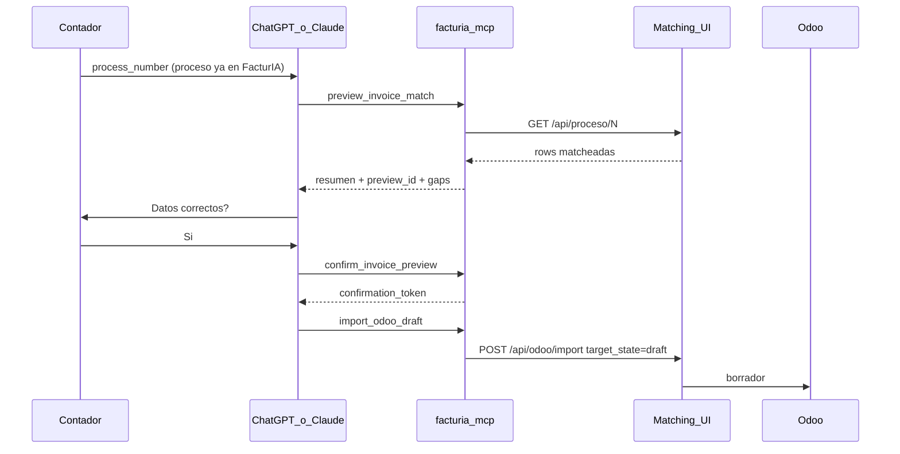

# MCP FacturIA Matching (contadores)

Servidor MCP que orquesta el matching UI desde ChatGPT / Claude / Cursor: **preview → el contador confirma → borrador Odoo**.

No reemplaza OCR de FacturIA ni el pipeline de impuestos. Llama la API REST de este proyecto.

## Flujo



Sin `confirmation_token` válido, `import_odoo_draft` **no escribe** en Odoo (gate server-side).

## Tools

| Tool | Efecto |
|------|--------|
| `odoo_health` | `GET /api/odoo/health` |
| `search_proveedor` | `GET /api/partners/search` |
| `init_erp_import` | FacturIA `GET /api/process/{id}/erp-import/init` → `import_id` + `token` |
| `preview_invoice_match` | Carga proceso, arma resumen, emite `preview_id` (opcional `import_id`/`token`) |
| `confirm_invoice_preview` | Contador OK → `confirmation_token` (TTL corto, un uso) |
| `import_odoo_draft` | Import **solo** `target_state=draft` con token; reenvía callback FacturIA |

## Endpoints FacturIA (ya documentados / integrados)

Mismo contrato que [api.md § Callback FacturIA](api.md#callback-facturia-erp-imports) y el chat de integración webhook:

| Ambiente | Base | Init | Webhook |
|----------|------|------|---------|
| Staging | `https://facturia-staging.sudata.co` | `GET /api/process/{id}/erp-import/init` | `POST /api/erp-imports/webhook` |
| Prod | `https://facturia.sudata.co` | igual | igual |

Webhook body (matching UI → FacturIA, tras import):

```json
{ "import_id": 12, "token": "…", "status": "completed", "comprobantes_importados": 1 }
```

El MCP **no** pega al webhook directo: pasa `import_id`/`token` a `POST /api/odoo/import` del matching UI, que ya llama `notify_erp_import_webhook` ([`erp_import_webhook.py`](../src/facturia_matching/facturia/erp_import_webhook.py)).

Auth para `init_erp_import`:

| Env | Uso |
|-----|-----|
| `FACTURIA_BASE_URL` | Override base (default según `PROCESS_SCHEMA`) |
| `FACTURIA_API_TOKEN` | `Authorization: Bearer …` |
| `FACTURIA_API_COOKIE` | Cookie de sesión FacturIA (alternativa) |

## Requisitos

1. Matching UI corriendo (`uvicorn` / deploy), p.ej. `http://127.0.0.1:8080`.
2. Proceso FacturIA ya existente (`process_number`) con `json_data` (OCR hecho).
3. Dependencia MCP: `pip install 'mcp>=1.2.0'` (o `pip install -e '.[mcp]'`).

Env:

| Variable | Default | Uso |
|----------|---------|-----|
| `FACTURIA_MATCHING_URL` | `http://127.0.0.1:8080` | Base del matching UI |
| `FACTURIA_MCP_SECRET` | random | Firma de tokens de confirmación |
| `FACTURIA_MCP_TRANSPORT` | `stdio` | Transporte FastMCP |

## Cómo correr

```bash
pip install -e '.[mcp]'
export FACTURIA_MATCHING_URL=http://127.0.0.1:8080
python -m facturia_matching.mcp
# o: facturia-mcp
```

### Claude Desktop / Cursor (stdio)

```json
{
  "mcpServers": {
    "facturia-matching": {
      "command": "python",
      "args": ["-m", "facturia_matching.mcp"],
      "env": {
        "FACTURIA_MATCHING_URL": "http://127.0.0.1:8080",
        "FACTURIA_MCP_SECRET": "cambiar-en-prod"
      }
    }
  }
}
```

Usá el mismo Python/venv donde está instalado el paquete.

### ChatGPT

Hace falta un host MCP **remoto** (HTTP/SSE) o Actions que apunten a los mismos endpoints. El transporte default de este repo es **stdio** (desktop). Remote hosting es un paso aparte de deploy.

## Qué no hace (aún)

- Subir la foto cruda a FacturIA (el proceso tiene que existir; OCR = FacturIA).
- Publicar comprobantes (`posted`).
- Editar filas vía MCP (hoy: preview de lo cargado; correcciones finas siguen en la UI o regenerando proceso).

## Código

| Módulo | Rol |
|--------|-----|
| `mcp/server.py` | Tools FastMCP + instrucciones |
| `mcp/api_client.py` | HTTP al matching UI |
| `mcp/facturia_client.py` | HTTP a FacturIA (`erp-import/init`) |
| `mcp/preview.py` | Resumen / gaps |
| `mcp/confirm.py` | Store preview + token de un uso (+ callback erp) |

Tests: `tests/test_mcp_confirm.py`.

## Pedidos a FacturIA (si quieren “mando la foto al chat”)

Con lo de hoy alcanza: **process_number** (+ opcional `init_erp_import`) → matching → confirm → draft → webhook.

Para UX foto-en-chat de punta a punta: endpoint autenticado de **alta de proceso desde archivo** → `process_id`. Init + webhook ya existen.
